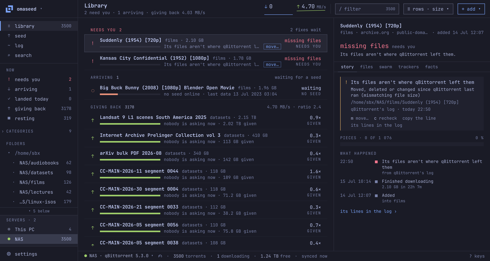
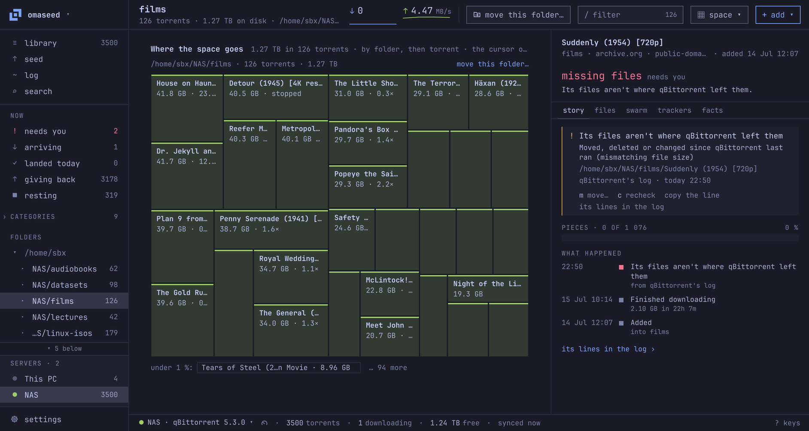
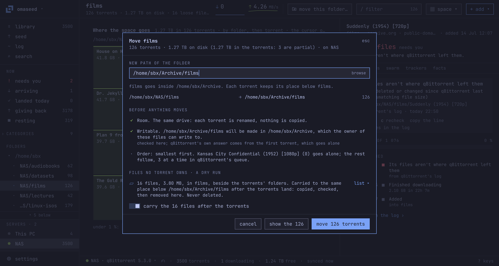
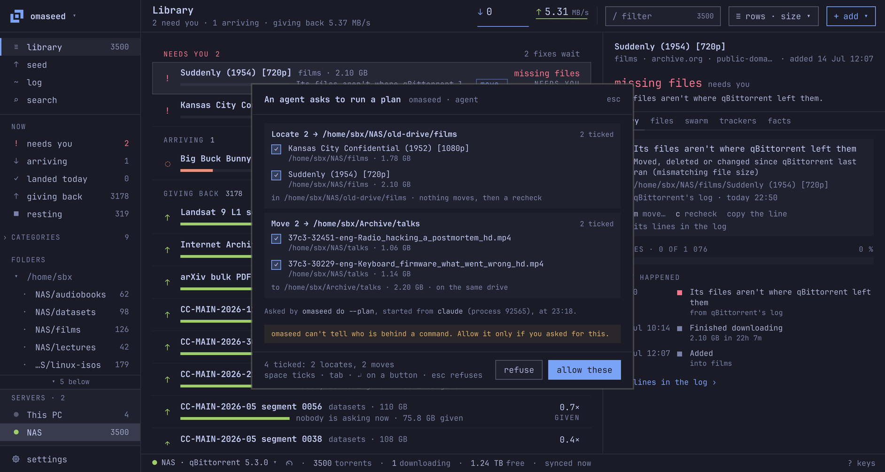
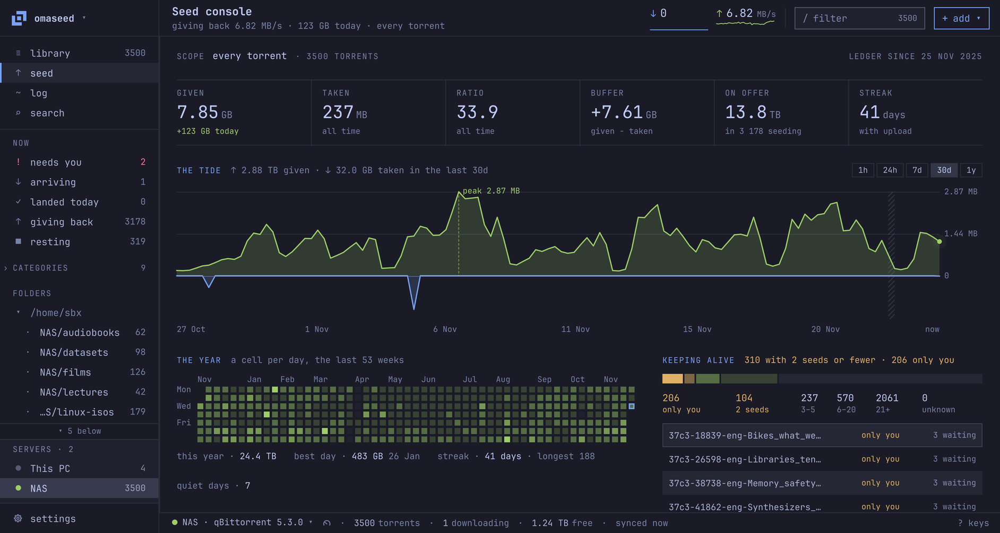
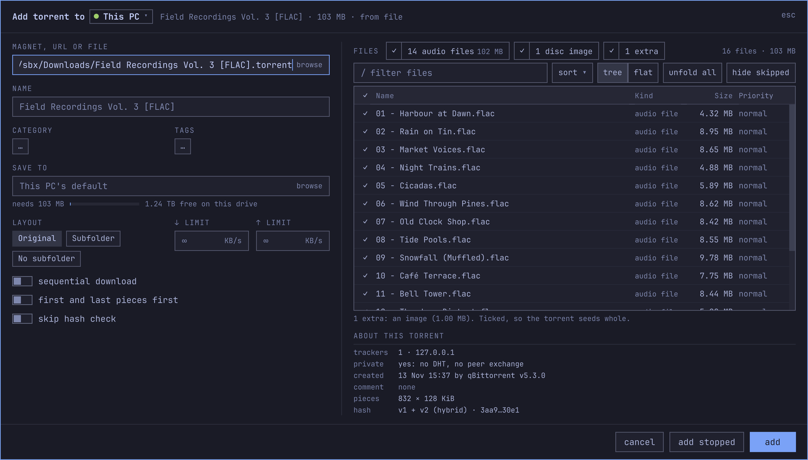
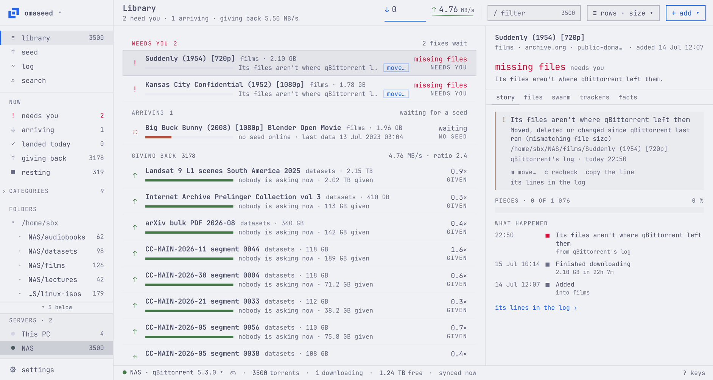
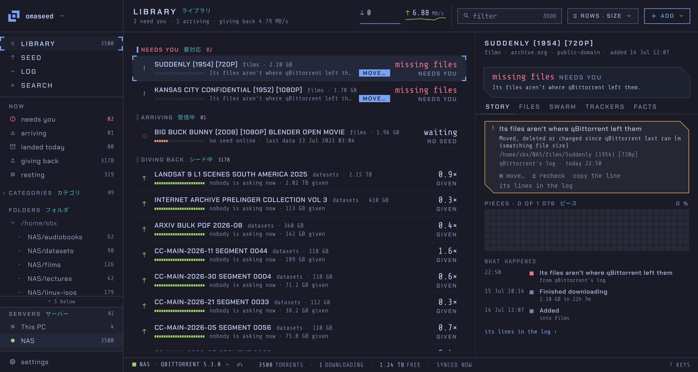
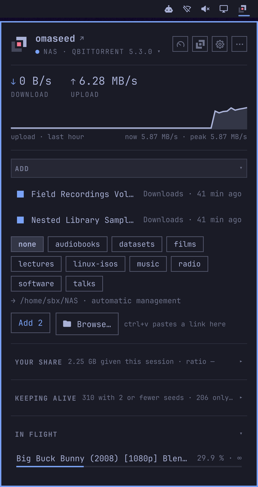

<h1>
  <picture>
    <source media="(prefers-color-scheme: dark)" srcset="docs/media/omaseed-lockup-dark.svg">
    
  </picture>
</h1>

[](https://github.com/tcballard/omarchy-badges)\
[omaseed.app](https://omaseed.app) · an independent community project, not affiliated with or endorsed by
Omarchy

**Torrents, finally at home on Omarchy.** omaseed is a native desktop client for
qBittorrent, Transmission or Deluge, on this PC, a NAS or a seedbox, or several at once. It looks
like the rest of your desktop, every action has a key, and it keeps the seeding history the
server does not. omaseed has no torrent engine of its own: the engine you already run does the
transferring, and omaseed is the window you see it through.



- **[See where your disk went](#the-window)**: rows grouped by what needs you, one sorted table,
  or space, a map of what each folder and torrent holds
- **[Move a whole folder](#moving)** to another drive, with the files no torrent owns, checked
  before anything is sent, and move it back later; on ntfs3, exFAT and FAT it checks the room
  before a file takes its whole size
- **[Your coding agent can look after your torrents](#ask-your-agent)**, as far as you let it:
  it reads, and fixes only what you allow, through one window that asks you
- **[The seed console](#the-seed-console)**: what you give back, from an hour to a year, kept by
  omaseed itself
- **[Any engine, any server](docs/ENGINES.md)**: qBittorrent, Transmission or Deluge, this PC or
  a NAS; secrets in the system keyring; a library moved from one engine to another
- **[At home on Omarchy](#on-omarchy)**: every theme live, the bar widget, Trigger › Torrents in
  the Omarchy menu, keyboard first, and a second skin

What it leaves out, on purpose: a torrent engine of its own, cross-seeding and *arr automation,
and the server-side things a desktop app has no use for, such as multiple users or metrics.

## Install

On Arch and Omarchy, one line downloads the latest release, already built, and installs it;
pacman pulls Qt and the rest from the Arch repos:

```
curl -fLO https://github.com/diogochaves/omaseed/releases/latest/download/omaseed-x86_64.pkg.tar.zst && sudo pacman -U omaseed-x86_64.pkg.tar.zst
```

You need a torrent engine, on this machine or another: **qBittorrent** 5.2 or newer with its Web
UI on, **Transmission** 4.1 or newer with remote access on, or **Deluge** 2.1 or newer through
deluge-web. What each needs, and what omaseed does on each: [docs/ENGINES.md](docs/ENGINES.md).

omaseed is not in a repo yet, so `pacman -Syu` does not update it: for a new release, run the
same line again, then `omaseed --quit` so the new one starts. (A bare `sudo pacman -U <url>`
stops at "failed retrieving file ….sig": pacman wants a signature for a package it downloads
itself.) An AI agent installing omaseed for you cannot type your password, so it should hand you
the line.

### Build from source

The latest release, built on your machine:

```
git clone https://github.com/diogochaves/omaseed.git
cd omaseed/packaging/arch
makepkg -si
```

`makepkg -si` asks for your password: pacman installs the build dependencies, then omaseed.
An AI agent installing omaseed for you cannot type it, so it should clone the repo and hand
you that command. With the dependencies already installed, it can build with plain
`makepkg` and hand you `sudo pacman -U omaseed-[0-9]*.pkg.tar.zst` instead.

### Turn on the Omarchy extras

The package installs the `omaseed` binary, its `.desktop` file and D-Bus service
file, icons, the MIT licence, the bar widget (`/usr/share/omaseed/plugin`) and three
Omarchy extras under `/usr/share/omaseed/` that you turn on yourself, since a package must
not edit your config:

- **A Hyprland window rule.** omaseed paints its own translucent background; the rule stops
  Omarchy's default window opacity from stacking on top of it. Link it, then add
  `require("hypr.omaseed")` next to your other `require("hypr...")` lines in
  `~/.config/hypr/hyprland.lua` and run `hyprctl reload`. Add the line only after the link
  exists: a `require` that finds no file stops Hyprland's config from loading.

  ```
  ln -sf /usr/share/omaseed/hyprland/omaseed.lua ~/.config/hypr/omaseed.lua
  ```

- **A theme hook**, so a theme change repaints omaseed at once:

  ```
  ln -sf /usr/share/omaseed/hooks/theme-set.d/omaseed ~/.config/omarchy/hooks/theme-set.d/omaseed
  ```

- **Torrents in the Omarchy menu**, under Trigger › Torrents (`omarchy menu summon torrents`):
  open omaseed, add a torrent, search, pick a speed, pause and resume, switch servers,
  settings. Turn on Settings › Appearance › **In the Omarchy menu**: omaseed adds its block to
  `~/.config/omarchy/extensions/omarchy-menu.jsonc`, changes nothing else in that file, keeps
  Servers › in step with your servers, and takes the block away when you turn it off. It is
  off until you do. To copy it by hand instead, take the lines from `// >>> omaseed` to
  `// <<< omaseed` in `/usr/share/omaseed/omarchy-menu.jsonc` and put them before the file's
  last `}`; the switch then reads as on. A hand copy has no Servers › rows: those list your
  servers, so only omaseed writes them. omaseed is in the menu's Apps list without any of it.

## First run

With no server set up, omaseed opens on a short setup instead of the library. `esc` leaves
at any point.

1. **Choose a server.** omaseed looks for one on this machine (the desktop qBittorrent's own
   settings, a listening port 8080, a `qbittorrent` Docker container, a running
   `qbittorrent-nox`; Transmission's port 9091 and its daemon; Deluge's deluge-web on 8112 and
   its daemon) and offers what it finds, one
   row per engine. You can always connect to a remote server
   instead. If nothing is found, a third choice installs `qbittorrent-nox` here: two
   commands to copy, or a button that runs them through `pkexec`.
2. **Sign in.** The address, a name, and how the server checks who you are: an API key, a
   username and password, or none. **test** recognises the engine and shows its version and
   how many torrents it has before you go on; **open web UI** takes you to where an API key is made.
   A server on HTTPS with its own certificate shows the certificate's fingerprint and asks
   before trusting it.
3. **Links.** Make omaseed the app that opens magnet links and `.torrent` files, or **not
   now** (Settings › General can do it later).
4. **The bar.** On Omarchy, put omaseed's widget in the bar, or **not now**.

## The window



The rail asks five questions (`1` to `5`): what needs you, what is arriving, what landed today,
what is giving back and what is resting. The library answers in one of three displays, from the
tool beside the filter, remembered for each folder, category, tag and question:

- **Rows**, grouped under the five questions, each torrent saying in words what matters now
  ("waiting · no seed", "ready in 3 min") before any figure.
- **The table**, one sorted list with the columns you pick.
- **Space**: a map of where the disk goes, by folder, then torrent; the folder under the cursor
  can be moved from there.

The details tell a torrent's story, newest first: what went wrong, a move, a rename, a new
category, when it finished, and its lines in the engine's log. Its files are grouped by kind
(videos, audio, subtitles, images, books, archives, disc images, extras), each kind with its
count and size, ticked or skipped at once. Pick torrents and a bar floats over the list with the
menu's verbs; what an action came to shows in a strip above it. `:` finds commands, settings,
servers and torrents in one box; holding `alt` shows every control's key, and `?` lists them all
([docs/KEYS.md](docs/KEYS.md)).

## Moving



Right-click a folder in the rail (or pick it and press `M`) to move the whole folder to another
drive: its torrents, then the files no torrent owns (subtitles you added, covers, notes), copied,
checked and removed only once they have landed. Before anything is sent, the sheet checks the
room on each drive, that the new place can be written, files already there and automatic
management. Torrents go smallest first, a band under the title follows them until the last one
lands (with pause and resume, even on a server whose disks omaseed can't see), and a summary
ends it with **recheck** and **move back…**. `m` moves just the torrents you picked, to the places
you moved things lately or the library's folders.

**Move back** takes the last 20 moves, or 30 days of them, from a torrent's details, the log or
`:`. A torrent goes back only if it is still where that move put it, and the files a folder move
carried come back too. Quitting while a move runs asks first, and a paused move picks up at the
next start.

**The drive it lands on.** On ntfs3, exFAT and FAT a file you tick takes its whole size the
moment it is wanted. The add sheet and details › Files name the drive's file system, check the
room before a tick reaches the server, and name files of 4 GiB or more on FAT32, with "skip
these". A tick that adds more than 1 GiB, or one that doesn't fit, waits 3 s with Undo (`u`). A
torrent whose files are gone says where it last saw them; one on a drive that isn't mounted says
to plug it in and recheck; and `omaseed do locate <hash> --to FOLDER` points a torrent at files
you moved yourself, after checking every file is there at its size.

## Ask your agent

Ask Claude Code, Codex, pi or Gemini why a download stopped, and it asks the running omaseed.
Everything that changes a torrent is off until you turn it on, moves and removes always ask you
first, and no command deletes a file.



**What it may do** is Settings › General › Agents, four lines:

| Line | Levels | What it covers |
|---|---|---|
| Reads | on, off | `status`, `errors`, `log`, `moves` |
| Fixes | off, ask, allow | retry, start here, recheck, reannounce, pause, resume, dismiss, locate |
| Moves | off, ask | move to a folder, move back |
| Remove | off, ask | a torrent whose files are gone, never its files |

`omaseed do <action> <hash…>` runs a fix the window offers, when its line allows it; `do
--list` says what is allowed now, and `--dry-run` makes every check and does nothing. `do --plan
FILE` checks a whole list first (one refused line runs nothing), then opens one window that asks
for all of it, each torrent ticked so you can untick some. Esc refuses, and nothing happens if
nobody answers in 2 minutes. What an agent did ends in "by an agent" on the strip and in the
torrent's story, and a removed torrent is kept 30 days for **add back**. Deleting files,
renaming, categories and tags, adds, settings and servers stay yours. `omaseed help do` lists
every action; `omaseed help agents` prints deny rules for your agent's own settings, filled in
with your server, so the agent stays out of the server itself.

**What it may read**, as a word after `omaseed`:

```
omaseed status    # the server, what it is doing, how many need you
omaseed errors    # every torrent that needs you, why, and its fix
omaseed log       # qBittorrent's log: warnings and worse, the last 50 lines
omaseed moves     # moves running now, and the last ones that landed
```

Each prints a few lines in the window's words; `--json` prints one JSON object instead.
`omaseed help <word>` lists a word's options (`errors --server NAME`, `log --level`,
`--lines`, `--since`, `--torrent`, `moves --landed N`). The words only read: none changes a
torrent or switches servers. omaseed has to be running (in the tray is enough); a word never
starts it, and says so with exit 3 when it isn't. Exit 4 means that server can't answer now
(not the one omaseed is on, unreachable, or no log to read).

omaseed's guide for agents is a skill: a short map of the words, their JSON and exit codes,
and how to make a skin, with pages an agent reads when the task needs them.

```
omaseed skill link     # link it where coding agents look for skills
omaseed skill status   # which agents have it
omaseed skill unlink   # take the links out
omaseed skill          # print the map (omaseed skill library, skins, files: a page)
```

`skill link` puts a link named `omaseed` to the installed skill
(`/usr/share/omaseed/agents/skill/`) in `~/.agents/skills/` and `~/.claude/skills/`, and in
Codex's, pi's, Gemini's and Hermes' skill folders when those agents are installed. Then an
agent started anywhere loads it when you ask about a download or omaseed's look. It never
touches a folder or a link of yours named `omaseed`, and `unlink` removes only its own links.
Nothing is linked until you ask: not at start, not by the package. Settings › General ›
Agents says the same and has a button for it. `omaseed --skill` is another spelling of
`omaseed skill`.

On every start omaseed also writes the map to `~/.config/omaseed/AGENTS.md` (with a
`CLAUDE.md` that points at it), so an agent started in that folder reads it too. Torrent
names, folders and log lines go to whatever model your agent uses; logins, API keys and
tracker passkeys never leave omaseed.

## The seed console



Your engine counts what you upload but keeps no history of it. omaseed keeps its own: `` ` ``
flips the window to what you have given and taken, the upload tide from an hour to a year, a
cell for every day of the last year, the torrents few others still seed, a ratio ladder and the
trackers you seed to. The rail, the filter and a selection scope it. The history lives in
`~/.local/share/omaseed/ledger/`, from the day you start using omaseed, so it stays when a server
is replaced.

## Adding torrents



Magnet links and `.torrent` files open in omaseed, from the browser, the file manager, the
clipboard, a drag or your Downloads folder; one handed over from outside opens the add sheet in a
small window on the workspace you are on. The sheet knows your library: your newest downloads
wait in it, a torrent you already have is caught before it is added twice, and when another
torrent already has the same files on disk, one click saves this one beside them so it seeds
without downloading. It says what the torrent needs on that drive and what it leaves.

**When a torrent errors**, omaseed reads the engine's log, ties each line to its torrent and says
it in plain words: the row reads the short cause ("disk full", "no access"), and the story opens
with what went wrong, the folder, and the keys that fix it. A move or a rename the engine
accepted and then couldn't do says so on the torrent too.

## On Omarchy

### Theme and skins

 

omaseed reads the same `colors.toml` and `shell.toml` as the rest of the Omarchy shell and
repaints as soon as `omarchy-theme-set` runs, on every bundled theme. Text size follows
`shell.toml`'s `[font] base-size`, and in the Omarchy skin window corners follow Hyprland's
rounding. Without Omarchy it uses a bundled Tokyo Night at base size 12.

The skin is the form the colours are drawn in. **Omarchy** (the default) is the shell's own;
**Console** draws omarchy-console's look: cut corners, brackets on the cursor's row, square
lamps, tracked upper-case labels with kana. **Follow the desktop** draws Console while
omarchy-console's skin is on, and honours its `fx.fonts = system`. Console's fonts are optional
(Chakra Petch, Share Tech Mono, Noto Sans CJK JP, Material Symbols Sharp); a missing one is
drawn in a stand-in, and Appearance says which.

Settings › Appearance has: the skin, follow the Omarchy theme, base size, the window's ground (opaque, or
translucent with its transparency), tray icon (`auto` hides it while the bar widget runs), bar
widget, the scroll hint, the rail's surface tint (off, 4 % or 8 %), tracker hosts, where the
details panel sits, where the speeds are shown (the title bar or the status line), and the
sending rows' pulse.

### The bar widget



The widget, *Omaseed*, mirrors omaseed in the Omarchy bar: its arrows light while something
downloads or uploads, and a click opens a popup with the speeds, an hour of upload, a list of
`.torrent` files to add, today's share, the torrents you keep alive, and what is downloading
and what finished. It never talks to qBittorrent itself; it reads what omaseed writes and
asks omaseed to act. While it runs, the tray icon steps aside, and nothing goes with it: the
popup's ⋯ is the tray's menu (the servers, alternative limits, pause or resume torrents,
settings, quit). Pause Torrents stops what is running and remembers it; Resume Torrents starts
exactly those again, never a torrent you had kept stopped.
A speed picked from out here, or over the bus (`PickAltSpeed` off, turtle or burst), sends a
notice once it has taken effect: what was picked and its limits.

First run offers it, Settings › Appearance › In the bar chooses the widget, the tray icon,
both or neither, and from a terminal:

```
omaseed --install-bar-widget
```

That links `~/.config/omarchy/plugins/chaves.omaseed` to the installed widget, so upgrading
omaseed upgrades the widget too. More in [plugin/README.md](plugin/README.md).

<br clear="right">

### Make it yours

Ask your coding agent for a look ("make omaseed warmer, and rounder") and it makes you a skin of
your own. A skin is data, never code: a `skin.json` in `~/.config/omaseed/skins/<name>/` with
grounds, lines, cuts, rounding, fonts, label voices, densities and glyphs, drawn in your Omarchy
theme's colours and kept readable on every theme. The agent works with four words, which you
can type too:

```
omaseed skin list               # every skin, where it lives, whether it reads
omaseed skin clone console warm # start one from a copy (of omarchy, console or one of yours)
omaseed check warm              # what it reads and drops, and a picture, with no display
omaseed skin use warm           # draw it in the open window, and keep it
```

`check` draws a fixed sheet on invented torrents in your theme, so your library never goes to
the agent's model. The way back: `omaseed skin use omarchy`. To share one, publish its folder
with the topic `omaseed-skin`; to add someone's, read every file and `omaseed check` it first.

## More

### Search

`ctrl+f` searches through the search plugins of the qBittorrent you're on: small Python files
you choose and install yourself (Settings › qBittorrent › Search plugins). omaseed names, ships
and suggests none, and never asks a site itself. Results fill in as each plugin answers, one row
per torrent with the other copies folded in, saying what is already yours ("in your library",
"likely on disk"); a plugin that fails or is slow is named, with the reason from qBittorrent's
log. `enter` opens the add sheet with its magnet.

### Create a torrent

`ctrl+n`, or a folder dropped on the window. **For anyone**, it seeds at once from where the
files are, nothing copied or moved, and its magnet is on the clipboard. **For a private
tracker**, the announce comes from your newest torrent there, its passkey only ever shown as
dots, and the private flag, v1 and source tag filled in; the `.torrent` is saved to your
Downloads for the upload, and when the site's copy comes back, the add sheet points it at your
folder so it seeds without downloading. The server's qBittorrent hashes it (Web API 2.10.4 or
later).

### Backups

Settings › Backup saves omaseed's servers, settings and seeding history to one `.omaseed`
file, and restores from one (keeping a copy of what it replaces first). Automatic copies run
weekly by default (or daily, or off) into `~/.local/share/omaseed/backups/`, keeping the last
four. Passwords and API keys are not in a backup; the keyring keeps those. A backup carries a
copy of each qBittorrent server's settings; a Transmission's or a Deluge's settings stay on
it, as Settings › Backup says. Torrents are in no backup of omaseed's: each engine's group in
Settings ends with its own Backup, which exports a server's torrents to a file and imports
one from any engine.

## Troubleshooting

- **Where is the tray icon?** With the bar widget running, `auto` hides it. Otherwise the
  Omarchy shell may keep it behind the tray's chevron; pin `io.github.diogochaves.omaseed`
  in the shell's tray settings.
- **The window is see-through.** By design: the theme's background at about 90 %, set in
  Settings › Appearance › Window transparency. If it looks more transparent than that, the
  Hyprland window rule above is not on.
- **No notifications.** They go through `org.freedesktop.Notifications`, so the shell's
  notification service has to be running.
- **See the logs.** Qt logs go to the journal; `QT_FORCE_STDERR_LOGGING=1 omaseed` prints
  them in the terminal instead.
- **Try it without a server.** `omaseed --demo table` opens a made-up library.
  `omaseed --help` lists the other demos.
- **Where things live.** `~/.config/omaseed/servers.json` (servers), `state.json` (settings
  and window state) and `secrets/` (credentials when there is no keyring);
  `~/.local/share/omaseed/ledger/` (seeding history) and `backups/`;
  `~/.config/autostart/` when Start at login is on.
- **Run first run again.** Remove `~/.config/omaseed/servers.json` and start omaseed.

## Developing

Needs Qt 6.8 or newer (with its Linguist tools, Arch's `qt6-tools`), CMake and Ninja. On Arch
the Qt tools (`qmllint`, `qmlformat`,
`qmltestrunner`) live outside `PATH`:

```
export PATH="/usr/lib/qt6/bin:$PATH"
cmake -S . -B build -G Ninja -DCMAKE_BUILD_TYPE=Debug
cmake --build build
ctest --test-dir build --output-on-failure -LE live   # unit and QML tests
./build/omaseed
scripts/dev/lint.sh build                             # qmllint and clang-format
cmake --build build --target update_translations      # after adding a `%n` string
```

To build a package from the working tree instead of a release:

```
mkdir -p build/makepkg-scratch && cp packaging/arch/PKGBUILD.local build/makepkg-scratch/PKGBUILD
cd build/makepkg-scratch && makepkg -f
```

CI builds with `-DOMASEED_WERROR=ON`. [docs/TESTING.md](docs/TESTING.md) covers the live tests
(throwaway servers from `scripts/dev/test-server.sh`, never your own library), the walks in an
omabox, the visual check and the manual test plans. [docs/ARCHITECTURE.md](docs/ARCHITECTURE.md)
is how the code is laid out and the theme rules every QML file follows;
[docs/05-ui-spec-v2.html](docs/05-ui-spec-v2.html) is the design and the numbered boards after it
design one feature each; [docs/DECISIONS.md](docs/DECISIONS.md) keeps the rulings the code
cites; [docs/RELEASING.md](docs/RELEASING.md) is how a release is cut.

## Built with omabox

No desktops were harmed in the making of omaseed. And no mouse was captured. Every window,
scale and multi-monitor check ran inside [omabox](https://github.com/diogochaves/omabox), an
invisible Omarchy desktop, so the AI agent building omaseed never touched the desktop it was
building for.

## License

MIT. omaseed talks to qBittorrent, Transmission and Deluge only through their public APIs
(the Web UI API, the JSON-RPC, deluge-web's JSON API) and contains no code of any of them.
