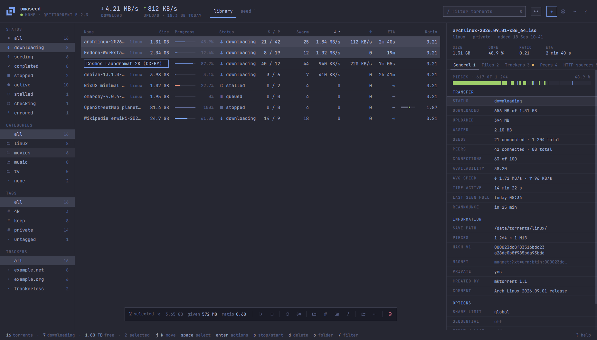
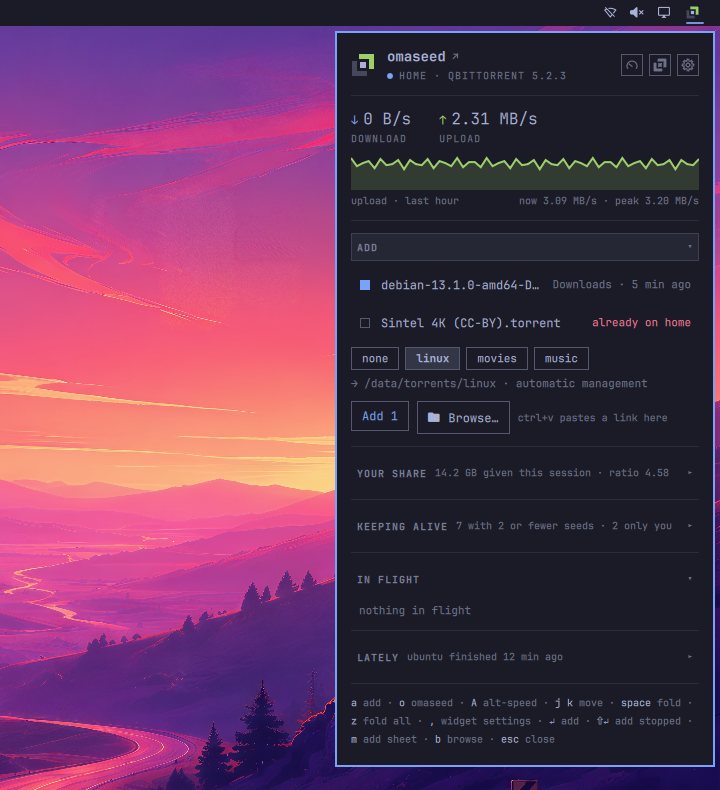
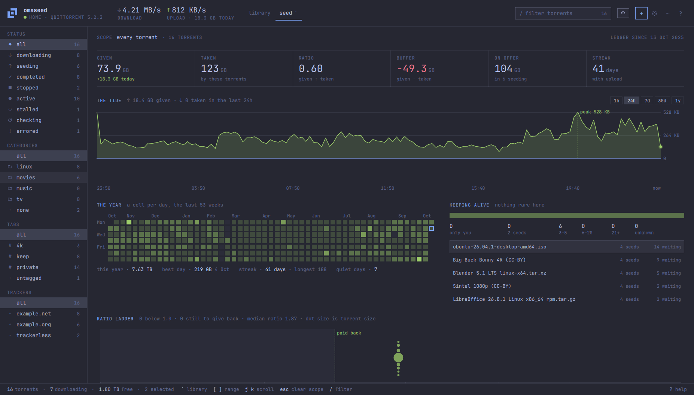
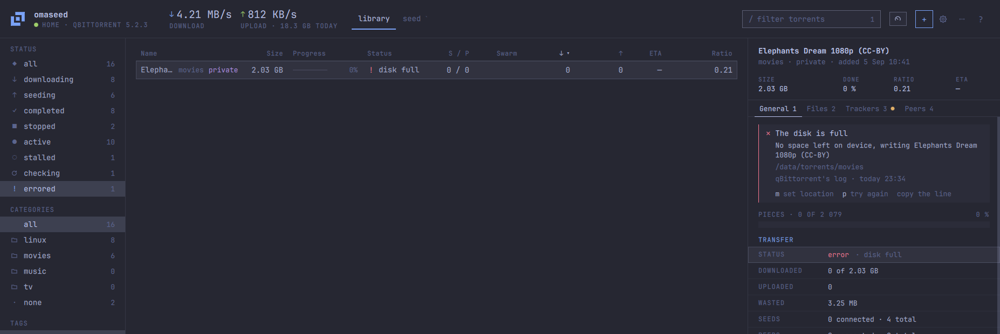
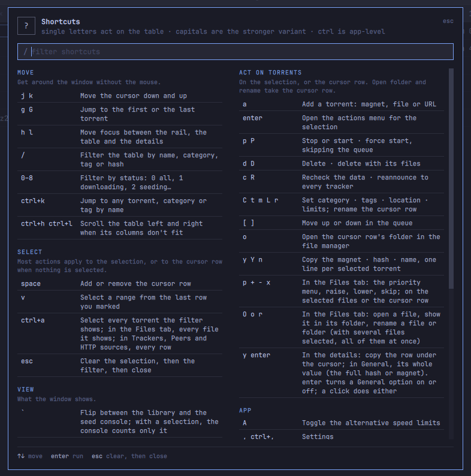
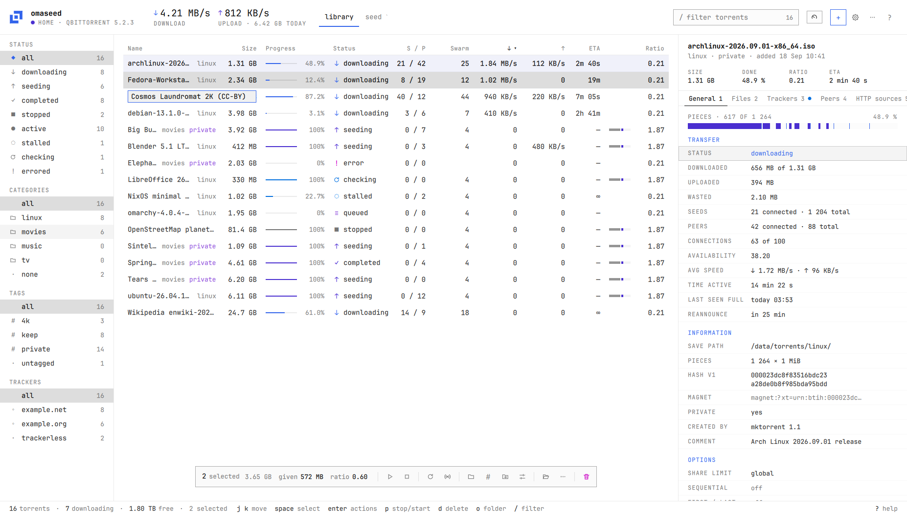

<h1>
  <picture>
    <source media="(prefers-color-scheme: dark)" srcset="docs/media/omaseed-lockup-dark.svg">
    
  </picture>
</h1>

[](https://github.com/tcballard/omarchy-badges)\
[omaseed.app](https://omaseed.app) · an independent community project, not affiliated with or endorsed by
Omarchy

**Torrents, finally at home on Omarchy.** omaseed is a native desktop client for one
qBittorrent server or many: this PC, a NAS, a seedbox, or all of them at once. It looks like
the rest of your desktop and repaints the moment the Omarchy theme changes, every action has a
key, and it keeps the seeding history qBittorrent does not. It opens `magnet:` links and
`.torrent` files, lives in the Omarchy bar or the tray, and speaks up when a download
finishes, a server goes away or a disk fills up.



omaseed has no torrent engine of its own: qBittorrent, local or remote, does the
transferring, and omaseed is the window you see it through. Built for Omarchy, it runs on any
Linux, with a bundled theme when Omarchy is not there.

- **The seed console**: what you give back, from the last hour to the last year, kept by
  omaseed itself
- **Knows your library before you add**: your newest downloads waiting, files already on disk
  to seed from, duplicates caught before they're added
- **Says why a torrent errored**, in plain words, with the keys that fix it
- **In your bar**: a widget with the speeds, an hour of upload and what to add
- **Keyboard first**: every action has a key, and `?` lists them all; the mouse works
  everywhere too
- **Every Omarchy theme, live**, the light ones included
- **Any server**: an API key, a username and password, or none; secrets in the system keyring
- **Careful with your data**: deleting files another torrent still seeds, or the last copy
  anyone has, asks first
- **Backs itself up**, seeding history included

What it leaves out, on purpose: a torrent engine of its own, cross-seeding and *arr
automation (that is [qui](https://github.com/autobrr/qui) and autobrr's ground), and the
server-side things a desktop app has no use for, such as multiple users or metrics.

## Install

### Arch / Omarchy

```
curl -fLO https://github.com/diogochaves/omaseed/releases/latest/download/omaseed-x86_64.pkg.tar.zst && sudo pacman -U omaseed-x86_64.pkg.tar.zst
```

That downloads the latest release, already built, and installs it; pacman pulls Qt and the
rest of what omaseed needs from the Arch repos. (A bare `sudo pacman -U <url>` stops at
"failed retrieving file ….sig": pacman wants a signature for a package it downloads itself,
not for a file already on disk.) omaseed is not in a repo yet, so `pacman -Syu` does not
update it: for a new release, run the same line again. An AI agent installing omaseed for
you cannot type your password, so it should hand you the line.

**You need** qBittorrent 5.2 or newer with its Web UI turned on (`Tools → Options → Web UI`
in the desktop app, or `qbittorrent-nox`), on this machine or another. omaseed signs in with
an API key, a username and password, or nothing for a server that lets localhost in. It
never installs qBittorrent itself, except when you accept first run's offer below.

**What the package installs:** the `omaseed` binary, its `.desktop` file and D-Bus service
file, icons, the MIT licence, the bar widget (`/usr/share/omaseed/plugin`) and three
Omarchy extras under `/usr/share/omaseed/` that you turn on yourself, since a package must
not edit your config:

- **A Hyprland window rule.** omaseed paints its own translucent background; the rule stops
  Omarchy's default window opacity from stacking on top of it. Link it, then add
  `require("hypr.omaseed")` next to your other `require("hypr...")` lines in
  `~/.config/hypr/hyprland.lua` and run `hyprctl reload`. Add the line only after the link
  exists: a `require` that finds no file stops Hyprland's config from loading.

  ```
  ln -sf /usr/share/omaseed/hyprland/omaseed.lua ~/.config/hypr/omaseed.lua
  ```

- **A theme hook**, so a theme change repaints omaseed at once:

  ```
  ln -sf /usr/share/omaseed/hooks/theme-set.d/omaseed ~/.config/omarchy/hooks/theme-set.d/omaseed
  ```

- **A "Torrents" row for the Omarchy menu**: copy it from
  `/usr/share/omaseed/omarchy-menu.jsonc` into `~/.config/omarchy/extensions/omarchy-menu.jsonc`.
  omaseed is in the menu's Apps list without it.

### Build from source

The latest release, built on your machine:

```
git clone https://github.com/diogochaves/omaseed.git
cd omaseed/packaging/arch
makepkg -si
```

`makepkg -si` asks for your password: pacman installs the build dependencies, then omaseed.
An AI agent installing omaseed for you cannot type it, so it should clone the repo and hand
you that command. With the dependencies already installed, it can build with plain
`makepkg` and hand you `sudo pacman -U omaseed-[0-9]*.pkg.tar.zst` instead.

## First run

With no server set up, omaseed opens on a short setup instead of the library. `esc` leaves
at any point.

1. **Choose a server.** omaseed looks for one on this machine (the desktop qBittorrent's own
   settings, a listening port 8080, a `qbittorrent` Docker container, a running
   `qbittorrent-nox`) and offers what it finds. You can always connect to a remote server
   instead. If nothing is found, a third choice installs `qbittorrent-nox` here: two
   commands to copy, or a button that runs them through `pkexec`.
2. **Sign in.** The address, a name, and how the server checks who you are: an API key, a
   username and password, or none. **test** shows the qBittorrent version and how many
   torrents it has before you go on; **open web UI** takes you to where an API key is made.
   A server on HTTPS with its own certificate shows the certificate's fingerprint and asks
   before trusting it.
3. **Links.** Make omaseed the app that opens magnet links and `.torrent` files, or **not
   now** (Settings › General can do it later).
4. **The bar.** On Omarchy, put omaseed's widget in the bar, or **not now**.

## The bar widget



The widget, *Omaseed*, mirrors omaseed in the Omarchy bar: its arrows light while something
downloads or uploads, and a click opens a popup with the speeds, an hour of upload, a list of
`.torrent` files to add, today's share, the torrents you keep alive, and what is downloading
and what finished. It never talks to qBittorrent itself; it reads what omaseed writes and
asks omaseed to act. While it runs, the tray icon steps aside, and nothing goes with it: the
popup's ⋯ is the tray's menu (the servers, alternative limits, stop and start all, settings,
quit).

First run offers it, Settings › Appearance › In the bar chooses the widget, the tray icon,
both or neither, and from a terminal:

```
omaseed --install-bar-widget
```

That links `~/.config/omarchy/plugins/chaves.omaseed` to the installed widget, so upgrading
omaseed upgrades the widget too. More in [plugin/README.md](plugin/README.md).

<br clear="right">

## The seed console



qBittorrent counts your uploads but keeps no history of them. omaseed keeps its own, so a
year of seeding is one key away: `` ` `` flips the window between the library and the seed console: what you have given and
taken, the upload tide over an hour to a year, a cell for every day of the last year, the
torrents only a few people still seed, a ratio ladder and the trackers you seed to. The rail
and the filter scope it, and so does a selection. omaseed keeps this history itself, in
`~/.local/share/omaseed/ledger/`, from the day you start using it, so it stays when a
server is replaced.

## When a torrent errors



qBittorrent's API only says a torrent is in error, never why. omaseed reads qBittorrent's own
log, ties each line to its torrent and says it in plain words: the table's status reads the
short cause ("disk full", "no access"), and General opens with what went wrong, the folder,
and the keys that fix it. A notice says so too, with its own switch in Settings ›
Notifications.

## Keys

Every key comes from one table (`src/ui/qml/Keymap.qml`), and the `?` sheet is drawn from
it. A capital letter is the stronger variant of its lower-case neighbour (`p` stop/start,
`P` force start; `d` delete, `D` delete with files).

<p align="center"></p>

**Move**

| Key | Does |
|---|---|
| `j` `k` | move down / up |
| `g` `G` | first / last row |
| `h` `l` | rail · table · details |
| `/` | filter |
| `0`–`8` | status filter |
| `ctrl+k` | jump to a torrent by name, hash or tracker |
| `ctrl+h` `ctrl+l` | scroll sideways |

**Select**

| Key | Does |
|---|---|
| `space` | toggle the row |
| `v` | select a range |
| `ctrl+a` | select every visible row |
| `esc` | clear the selection, then the filter, then close what is open |

**View**

| Key | Does |
|---|---|
| `` ` `` | seed console |
| `i` | details |
| `1`–`4` | details tab (in the details pane) |
| `s` | sort |
| `\|` | columns (`alt+↑` `alt+↓` reorder them) |
| `ctrl+b` | rail |
| `I` | details right · bottom · auto |
| `<` `>` | details smaller · larger |
| `H` `L` | fold / unfold every folder (Files tab) |
| `X` | hide skipped files (Files tab) |

**Act on torrents**

| Key | Does |
|---|---|
| `a` | add |
| `enter` | actions menu |
| `p` `P` | stop/start · force start |
| `d` `D` | delete · delete with files |
| `c` `R` | recheck · reannounce |
| `C` `t` `m` `L` `r` | category · tags · location · limits · rename |
| `[` `]` | queue up / down |
| `o` | open folder |
| `y` `Y` `n` | copy magnet · hash · name |
| `p` `+` `-` `x` | file priority (Files tab) |
| `O` `o` `r` | open · folder · rename a file (Files tab) |
| `y` `enter` | copy a value · change an option (General tab) |

**App**

| Key | Does |
|---|---|
| `A` | alternative speed limits |
| `,` `ctrl+,` | settings |
| `ctrl+shift+,` | qBittorrent's settings |
| `ctrl+.` | more actions |
| `q` | hide to the tray |
| `ctrl+q` | quit |
| `?` `F1` | every key |

Keys cannot be rebound yet. omaseed binds no global shortcut; to summon it with, say,
`super+shift+t` (free in Omarchy's default bindings, 4.0 and 4.5 alike), add a line to
`~/.config/hypr/bindings.lua` that launches `omaseed`: a second launch raises the running one.

```lua
o.bind("SUPER + SHIFT + T", "omaseed", { launch = "omaseed" })
```

## Theme



omaseed reads the same `colors.toml` and `shell.toml` as the rest of the Omarchy shell and
repaints as soon as `omarchy-theme-set` runs, on every bundled theme. Text size follows
`shell.toml`'s `[font] base-size`, and window corners follow Hyprland's rounding. Without
Omarchy it uses a bundled Tokyo Night at base size 12.

Settings › Appearance has: follow the Omarchy theme, base size, window transparency, tray
icon (`auto` hides it while the bar widget runs), bar widget, speed figures and trends,
surface tint, tracker hosts, and where the details panel sits.

## Servers

Settings › Servers lists every server, with **add**, **test**, **edit**, **remove** and
**set as default**. Switch between them from the rail's Servers group or here. Passwords
and API keys go to the system keyring through libsecret, or to a 0600 file under
`~/.config/omaseed/secrets/` when there is no keyring.

For a server whose files appear under another path here (a NAS mount, a seedbox), Settings ›
General's **path mapping** rewrites the server's save path before open folder.

Settings › qBittorrent edits the server's own settings (downloads, connection, speed,
BitTorrent, RSS, Web UI, advanced) without opening its web UI.

## Backups

Settings › Backup saves omaseed's servers, settings and seeding history to one `.omaseed`
file, and restores from one (keeping a copy of what it replaces first). Automatic copies run
weekly by default (or daily, or off) into `~/.local/share/omaseed/backups/`, keeping the last
four. Passwords and API keys are not in a backup; the keyring keeps those.

## Troubleshooting

- **Where is the tray icon?** With the bar widget running, `auto` hides it. Otherwise the
  Omarchy shell may keep it behind the tray's chevron; pin `io.github.diogochaves.omaseed`
  in the shell's tray settings.
- **The window is see-through.** By design: the theme's background at about 90 %, set in
  Settings › Appearance › Window transparency. If it looks more transparent than that, the
  Hyprland window rule above is not on.
- **No notifications.** They go through `org.freedesktop.Notifications`, so the shell's
  notification service has to be running.
- **See the logs.** Qt logs go to the journal; `QT_FORCE_STDERR_LOGGING=1 omaseed` prints
  them in the terminal instead.
- **Try it without a server.** `omaseed --demo table` opens a made-up library.
  `omaseed --help` lists the other demos.
- **Where things live.** `~/.config/omaseed/servers.json` (servers), `state.json` (settings
  and window state) and `secrets/` (credentials when there is no keyring);
  `~/.local/share/omaseed/ledger/` (seeding history) and `backups/`;
  `~/.config/autostart/` when Start at login is on.
- **Run first run again.** Remove `~/.config/omaseed/servers.json` and start omaseed.

## Developing

Needs Qt 6.8 or newer, CMake and Ninja. On Arch the Qt tools (`qmllint`, `qmlformat`,
`qmltestrunner`) live outside `PATH`:

```
export PATH="/usr/lib/qt6/bin:$PATH"
cmake -S . -B build -G Ninja -DCMAKE_BUILD_TYPE=Debug
cmake --build build
ctest --test-dir build --output-on-failure -LE live   # unit and QML tests
./build/omaseed
scripts/dev/lint.sh build                             # qmllint and clang-format
```

`-DOMASEED_WERROR=ON` turns warnings into errors (CI uses it); `-DBUILD_TESTING=OFF` skips
the tests.

The live tests (`ctest -L live`) talk to two throwaway qBittorrent servers that
`scripts/dev/test-server.sh` runs: `start` (port 8081, no login from localhost) and `start
--strict` (port 8082, real logins). The first `start --strict` makes a random login and API
key and saves them to `~/.config/omaseed/dev.env`, outside the repo; load it with
`set -a; . ~/.config/omaseed/dev.env; set +a`. Without it the strict tests skip and say why.

To build a package from the working tree instead of a release:

```
mkdir -p build/makepkg-scratch && cp packaging/arch/PKGBUILD.local build/makepkg-scratch/PKGBUILD
cd build/makepkg-scratch && makepkg -f
```

[docs/ARCHITECTURE.md](docs/ARCHITECTURE.md) is how the code is laid out and the theme rules
every QML file follows; [docs/05-ui-spec-v2.html](docs/05-ui-spec-v2.html) is the design and the
numbered boards after it design one feature each (open them in a browser);
[docs/DECISIONS.md](docs/DECISIONS.md) keeps the rulings the code cites;
[docs/RELEASING.md](docs/RELEASING.md) is how a release is cut.

## Built with omabox

No desktops were harmed in the making of omaseed. And no mouse was captured. Every window,
scale and multi-monitor check ran inside [omabox](https://github.com/diogochaves/omabox), an
invisible Omarchy desktop, so the AI agent building omaseed never touched the desktop it was
building for.

## License

MIT. omaseed talks to qBittorrent only through its public Web UI API and contains no
qBittorrent code.
