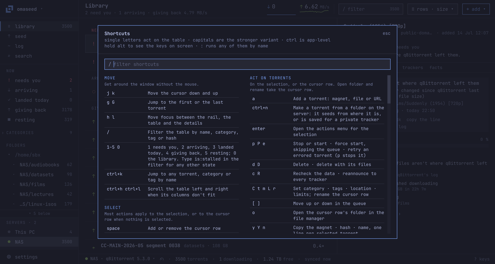

# Keys

Every key omaseed has, as the `?` sheet lists them. Back to the [README](../README.md).

Every key comes from one table (`src/ui/qml/Keymap.qml`), and the `?` sheet is drawn from
it. A capital letter is the stronger variant of its lower-case neighbour (`p` stop/start,
`P` force start; `d` delete, `D` delete with files). Keys are taught where you ask for them:
menus and tooltips name them, holding `alt` badges the controls on screen, and the `?` sheet
lists them all, one block the keys inside a sheet (add, move, settings). With torrents
selected, an action bar floats over the list: the torrent menu's verbs with their icons, more ›
for the rest and "esc" at its end.

<p align="center"></p>

**Move**

| Key | Does |
|---|---|
| `j` `k` | move down / up |
| `g` `G` | first / last row |
| `h` `l` | rail · table · details |
| `/` | filter (`is:stalled` and the like for any state) |
| `1`–`5`, `0` | needs you, arriving, landed today, giving back, resting; the library |
| `ctrl+k` | jump to a torrent by name, hash or tracker |
| `ctrl+f` | search the server's search plugins (`enter` asks, `↓` the results, `enter` add…, `space` the result, `c` `o` copy magnet · its page) |
| `ctrl+h` `ctrl+l` | scroll sideways |

**Select**

| Key | Does |
|---|---|
| `space` | toggle the row |
| `v` | select a range |
| `ctrl+a` | select every visible row |
| `esc` | clear the selection, then the filter, then close what is open |

**View**

| Key | Does |
|---|---|
| `` ` `` | seed console |
| `i` | details |
| `1`–`5` | story · files · swarm · trackers · facts (in the details pane; `6` web seeds) |
| `s` | sort |
| `:` show as … | rows, table or space, for the place on show (also the title bar's tool) |
| `\|` | columns (`alt+↑` `alt+↓` reorder them) |
| `ctrl+b` | fold the rail to its glyphs (or the tab on its edge; drag the edge to size it) |
| `I` | details right · bottom · auto |
| `<` `>` | details smaller · larger |
| `H` `L` | fold / unfold every folder (Files tab) |
| `X` | hide skipped files (Files tab) |

**Act on torrents**

| Key | Does |
|---|---|
| `a` | add |
| `ctrl+n` | create a torrent from a folder |
| `enter` | actions menu |
| `p` `P` | stop/start · force start |
| `d` `D` | delete · delete with files |
| `c` `R` | recheck · reannounce |
| `C` `t` `m` `L` `r` | category · tags · location · limits · rename |
| `[` `]` | queue up / down |
| `o` | open folder |
| `y` `Y` `n` | copy magnet · hash · name |
| `p` `+` `-` `x` | file priority (Files tab) |
| `O` `o` `r` | open · folder · rename a file (Files tab) |
| `F` | free the space, or add it again (Files tab) |
| `y` `enter` | copy a value · change an option (facts tab) |

**App**

| Key | Does |
|---|---|
| `A` | alternative speeds on or off (turtle, or the last preset picked; the status line's chip has both) |
| `,` `ctrl+,` | settings |
| `ctrl+shift+,` | the server's own settings (qBittorrent's, Transmission's or Deluge's) |
| `ctrl+.` | the omaseed menu (the mark): servers, alternative speeds, add, settings, quit |
| hold `alt` | show the keys of what is on screen |
| `q` | hide to the tray |
| `ctrl+q` | quit |
| `?` `F1` | every key |

Keys cannot be rebound yet. omaseed binds no global shortcut; to summon it with, say,
`super+shift+t` (free in Omarchy's default bindings, 4.0 and 4.5 alike), add a line to
`~/.config/hypr/bindings.lua` that launches `omaseed`: a second launch raises the running one.

```lua
o.bind("SUPER + SHIFT + T", "omaseed", { launch = "omaseed" })
```

